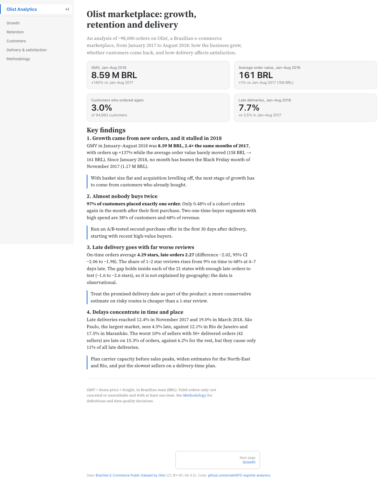

# Olist e-commerce analytics

[](https://github.com/mvakh975-wq/olist-analytics/actions/workflows/ci.yml)


**How did a Brazilian marketplace grow, do its customers come back, and what does late delivery cost?** An end-to-end analysis of ~98,000 real orders: dbt models in DuckDB with data tests, statistical analysis in notebooks, and a public dashboard.

**[→ Open the dashboard](https://mvakh975-wq.github.io/olist-analytics/)**

[Русская версия](README.ru.md)



## Key findings

Analysis period January 2017 – August 2018, valid orders only. Full write-up with recommendations: [`docs/findings.md`](docs/findings.md).

1. **Growth came from new customers, and it stalled in 2018.** GMV in Jan–Aug 2018 was 8.59 M BRL, 2.4× the same months of 2017, while the average order value stayed flat at ~160 BRL. No month in 2018 beat the Black Friday month of November 2017.
2. **Almost nobody buys twice.** 97% of customers placed exactly one order; only 0.48% of a cohort orders again the following month. Two high-value one-time-buyer segments are 38% of customers and 68% of revenue, the natural target for a second-purchase programme.
3. **Late delivery goes with far worse reviews.** On-time orders average 4.29 stars, late ones 2.27 (−2.02, 95% CI −2.06 to −1.98, Mann–Whitney p < 0.001). 68% of orders delivered 4–7 days late get a 1–2 star review, against 9% on time. The gap holds inside each of the 21 states with enough late orders and inside the five largest categories.
4. **Delays concentrate in time and place.** The late-delivery rate more than doubled year over year (3.5% → 7.7% for January–August), peaking at 12.4% in November 2017 and 19.0% in March 2018 against about 3% in calm months; São Paulo, the largest market, sees 4.5% late against 12.1% in Rio de Janeiro and 17.5% in Maranhão. The worst 10% of active sellers are late on 15.3% of their orders against 6.2% for the rest, yet they cause only 11% of all late deliveries.

## Business questions

| # | Question | Method | Where |
|---|----------|--------|-------|
| 1 | Is the business growing? | GMV, orders, AOV, freight share by month; year-over-year by category | [`01_growth`](notebooks/01_growth.ipynb), [Growth](https://mvakh975-wq.github.io/olist-analytics/growth) |
| 2 | Do customers come back? | Monthly cohorts by first purchase, retention curve, time to second order | [`02_retention`](notebooks/02_retention.ipynb), [Retention](https://mvakh975-wq.github.io/olist-analytics/retention) |
| 3 | Who are our customers? | RFM segmentation adapted to one-time buyers, action per segment | [`03_rfm`](notebooks/03_rfm.ipynb), [Customers](https://mvakh975-wq.github.io/olist-analytics/customers) |
| 4 | Does delivery affect satisfaction? | Score by delay; bootstrap CI, Mann–Whitney U, rank-biserial; checks inside states and categories | [`04_delivery_vs_reviews`](notebooks/04_delivery_vs_reviews.ipynb), [Delivery](https://mvakh975-wq.github.io/olist-analytics/delivery) |
| 5 | Where does logistics fail? | Late rate by month, state and seller | same as 4 |

## How it works

```
Kaggle (9 CSV) ─► scripts/download.py ─► data/raw/                      (not in git)
   ─► dbt + DuckDB: staging ─► intermediate ─► marts, 53 data tests    (olist.duckdb, not in git)
   ─► scripts/export_marts.py ─► data/marts/*.parquet + statistics     (in git, ~19 MB)
   ─► notebooks/: statistics and charts
   ─► scripts/export_marts.py site-data ─► ~0.5 MB of JSON/CSV aggregates
   ─► site/: Observable Framework, filters computed in the page ─► GitHub Pages
```

- **SQL models** ([`dbt/models`](dbt/models)): typed staging views, one enriched row per order, and marts per question: `fct_orders`, `dim_customers`, `mart_monthly_kpis`, `mart_cohort_retention`, `mart_rfm`, `mart_delivery_performance` and others.
- **Data quality** ([`docs/data_quality.md`](docs/data_quality.md)): every table profiled for nulls, duplicates and types before modelling, with a decision for each issue. dbt tests guard keys, relationships, accepted values and business rules (for example, no delay is ever computed for an order that was not delivered).
- **Tests** (pytest, 68): the dbt project is built on a sample of real rows chosen to contain every edge case found in profiling, and the marts are reconciled against totals computed straight from the raw files. CI runs lint (ruff, sqlfluff), dbt build, pytest and a dashboard build on every push.
- **Dashboard checks**: a Playwright script opens every page at desktop and phone widths in light and dark mode and fails on errors or horizontal scroll.

### Three things the data tried to hide

- **`customer_id` is not a customer.** Olist issues a new one per order, so retention computed on it is exactly zero. The person is `customer_unique_id`.
- **One order, several reviews.** 547 orders have more than one review and the scores differ in 202. Each order keeps the last answered one; orders without a review stay empty instead of counting as 0.
- **Empty months at the edges.** The data runs from September 2016 to October 2018, but the first and last months hold a handful of orders. Including them would distort every trend and make the newest cohorts look like they never returned.

## Run it yourself

Requires [uv](https://docs.astral.sh/uv/), Node.js 20+ and a free Kaggle account (`uv run kaggle auth login`, or a token in `~/.kaggle/access_token`; or download the archive manually into `data/raw/`).

```bash
uv sync
make data build export    # download the CSVs, build and test the dbt models, export the marts
make site                 # dashboard at http://127.0.0.1:3000
```

`make test` runs the test suite, `make lint` the linters. The notebooks read `olist.duckdb`; run them with `uv run jupyter lab`.

## Project structure

```
dbt/            dbt project: models (staging, intermediate, marts), tests, macros
notebooks/      00 profiling, 01 growth, 02 retention, 03 RFM, 04 delivery vs reviews
scripts/        download, CI fixture sample, export of marts and dashboard aggregates
site/           Observable Framework dashboard
data/marts/     exported marts (parquet)
tests/          pytest suite, CI fixture sample, Playwright check
docs/           design, data quality, findings, screenshots
```

## Data and license

Data: [Brazilian E-Commerce Public Dataset by Olist](https://www.kaggle.com/datasets/olistbr/brazilian-ecommerce), © Olist, CC BY-NC-SA 4.0. Derived files in `data/marts/` and `tests/fixtures/` are shared under the same license (see [`DATA_LICENSE.md`](DATA_LICENSE.md)). Code: MIT.
